# Guia de uso — Servio

O Servio é um app com dois modos:

- **Modo voluntário** (padrão): abas **Início**, **Agenda**, **Folgas** e **Perfil**.
- **Modo líder**: abas **Cultos**, **Escalar**, **Equipe** e **Painel**.

A chave **Líder** no topo troca o modo. Ela aparece só para quem lidera um ministério ou é administrador.
O app lembra a última escolha. O botão **⋯** (Mais opções) abre as telas extras e o tema claro ou escuro.

Os prints abaixo são de um celular (390 × 844).

## Instalar no celular

O app funciona no navegador. Instale na tela inicial para abrir como app e receber avisos.

- **Android (Chrome):** abra o endereço do app. Toque nos três pontos. Toque em **Instalar app** ou **Adicionar à tela inicial**.
- **iPhone (Safari):** abra o endereço do app. Toque no botão de compartilhar. Toque em **Adicionar à Tela de Início**. Precisa do iOS 16.4 ou mais novo. No iPhone, os avisos só funcionam com o app instalado.

Depois abra **Perfil** e ligue os avisos do celular.

---

## Modo líder

### 1. Primeiro acesso (administrador)

1. Abra o endereço do app.
2. Preencha o nome da igreja, o seu nome, o e-mail e a senha (8 caracteres ou mais).
3. Marque a autorização de dados e toque em **Criar**.

O app abre o assistente **Configurar a igreja**. Ele tem 3 passos. Você pode pular cada passo e voltar depois pelo endereço `/lider/configurar`.

| Passo 1 — Ministério | Passo 2 — Culto | Passo 3 — Convidar |
|---|---|---|
| 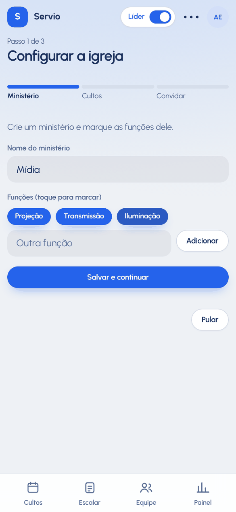 | 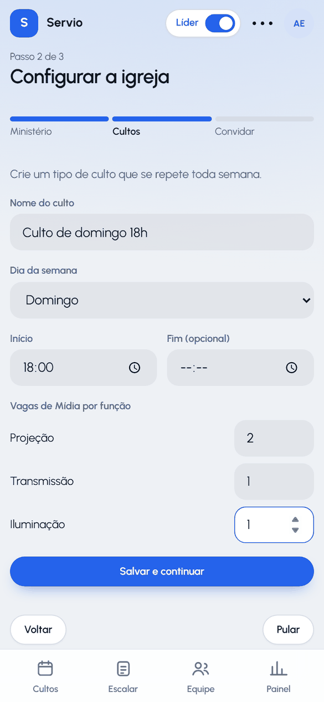 |  |

1. **Ministério:** escreva o nome (por exemplo, Mídia). Toque nas funções sugeridas para marcar. Para outra função, escreva em **Outra função** e toque em **Adicionar**. Toque em **Salvar e continuar**.
2. **Culto:** escreva o nome do tipo de culto (por exemplo, "Culto de domingo 18h"), o dia da semana e a hora. Informe quantas pessoas cada função precisa (por exemplo, 2 Projeção, 1 Transmissão e 1 Iluminação). Toque em **Salvar e continuar**. O app cria os cultos dos próximos 90 dias com as vagas vazias.
3. **Convidar:** toque em **Gerar link do convite**. Toque em **Enviar no WhatsApp** ou em **Copiar link**. O link vale 14 dias. Toque em **Concluir**.

### 2. Aprovar a equipe

Cada pessoa cria a conta pelo link e escolhe as funções onde quer servir. O pedido aparece na aba **Equipe**.

| Pedidos | Equipe aprovada |
|---|---|
| 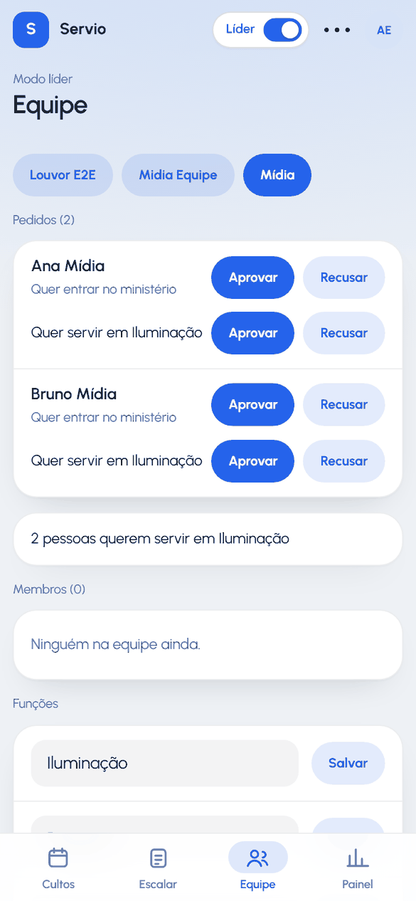 | 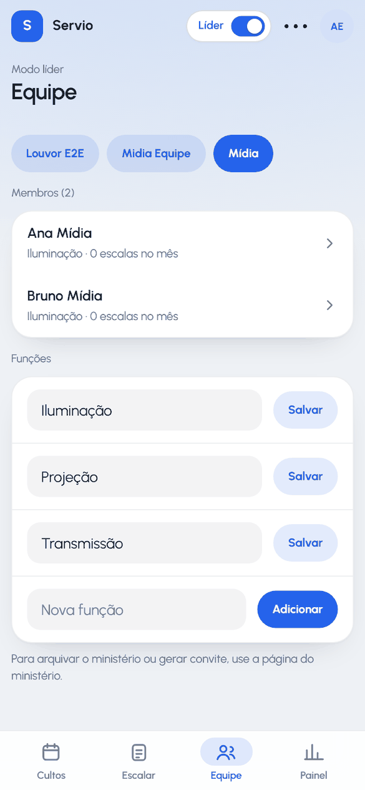 |

1. Abra **Equipe**. Se você lidera mais de um ministério, toque no nome dele no topo.
2. Em **Pedidos**, toque em **Aprovar** na linha "Quer entrar no ministério".
3. Toque em **Aprovar** em cada linha "Quer servir em …". Só as funções aprovadas entram na escala.
4. Para negar, toque em **Recusar**.

Toque no nome de um membro para ver as funções e as escalas dele no mês.

### 3. Ver os cultos do mês

A aba **Cultos** mostra o calendário. Cada culto tem uma pílula por ministério:

- verde: todas as vagas preenchidas;
- amarelo: falta gente (por exemplo, **Mídia 0/4**);
- cinza com "–": o ministério não tem vagas neste culto.

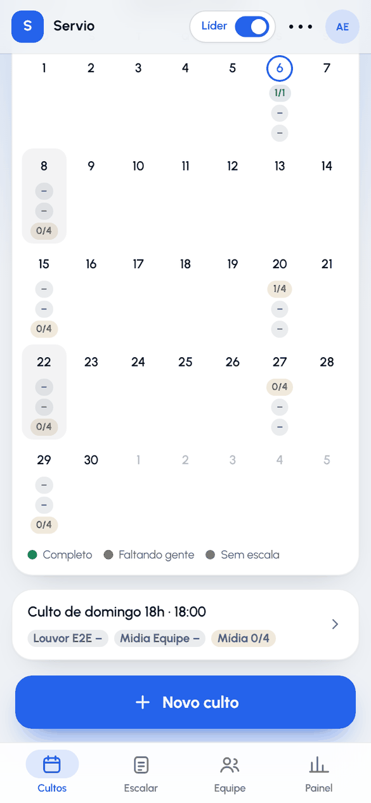

1. Toque num dia marcado. A lista do dia aparece abaixo do calendário.
2. Toque no culto para abrir as vagas.
3. Use as setas para mudar o mês.
4. Toque em **Tipos de culto** para mudar as vagas de um tipo. A mudança vale para os cultos futuros sem escala publicada.
5. Toque em **Novo culto** para um culto avulso.

### 4. Montar a escala do mês

| Escalar | Resumo da sugestão | Publicar |
|---|---|---|
| 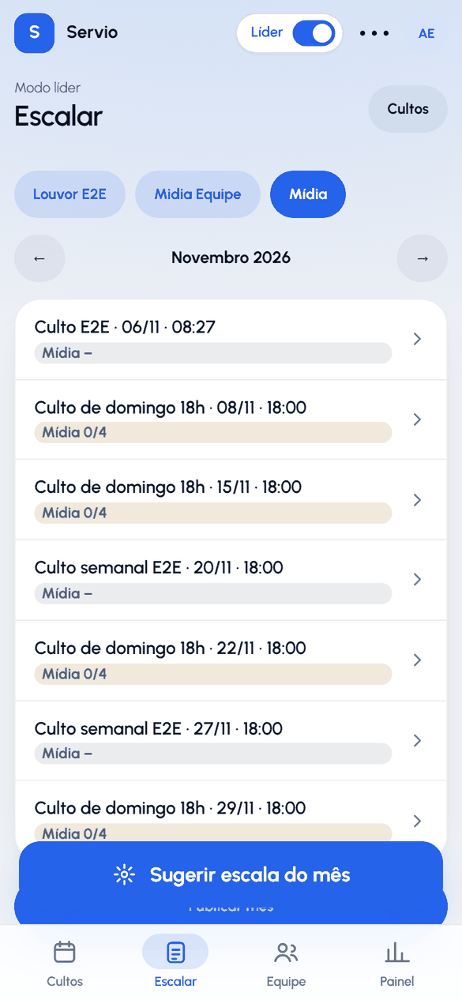 | 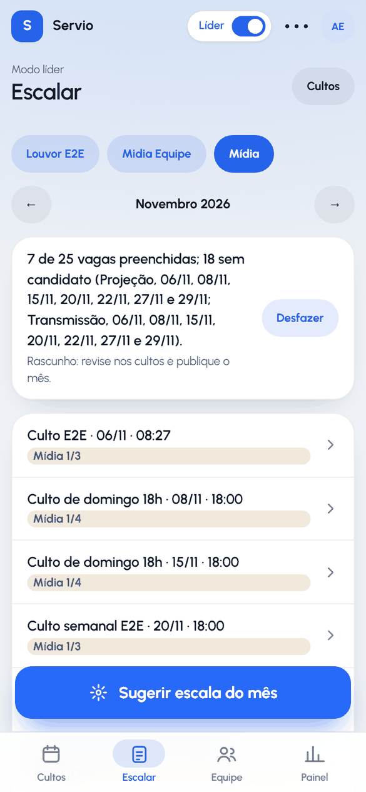 |  |

1. Abra **Escalar**. Escolha o ministério no topo e o mês nas setas.
2. Toque em **Sugerir escala do mês**. O app preenche só as vagas vazias das escalas em rascunho. Ele escolhe quem serviu menos nos últimos 60 dias e não está de folga nem no mesmo culto. Cada pessoa tem no máximo 4 escalas no mês.
3. Leia o resumo. Ele mostra quantas vagas ficaram preenchidas e as vagas sem candidato, por função e data.
4. Não gostou? Toque em **Desfazer**. O app esvazia só o que a sugestão preencheu.
5. Toque num culto para revisar. Toque em **Escolher** numa vaga vazia para pôr uma pessoa à mão. **Trocar** e **Remover** mudam uma pessoa já escolhida.
6. Toque em **Publicar mês** e depois em **Publicar e avisar**. Cada pessoa escalada recebe um aviso.

Na tela do culto, o botão **Publicar** publica só aquele culto.

### 5. Aprovar trocas

1. Toque em **⋯** (Mais opções) e em **Trocas**.
2. Em **Aguardando aprovação**, toque em **Aprovar** ou **Recusar**.
3. Em **Aprovação automática**, toque em **Ligar** para aprovar as trocas do ministério sem você.

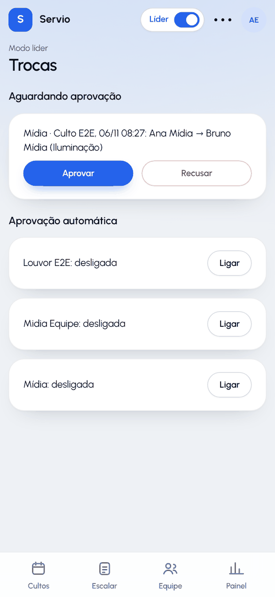

### 6. Painel

A aba **Painel** mostra a presença por mês, as escalas por voluntário e as vagas abertas dos próximos 30 dias. O botão de CSV baixa os dados.

### Outras tarefas do líder

- **Repertório (louvor):** abra a escala do culto e toque em **Repertório**. Inclua as músicas com tom e links. Use **Copiar** para repetir o repertório de outro culto.
- **Agradecer:** em **⋯ → Ministérios**, abra o ministério. Em **Membros**, toque em **Agradecer**. A pessoa recebe pontos.
- **Escolher outro líder (administrador):** em **⋯ → Ministérios**, toque em **Gerenciar**. Escolha a pessoa, escolha **Líder** e toque em **Definir papel**.
- **Senha esquecida (administrador):** abra o ministério da pessoa. Em **Membros**, escreva uma senha temporária e toque em **Definir**. A pessoa troca a senha no próximo acesso.

---

## Modo voluntário

### 1. Entrar pelo convite

| Conta | Onde quero servir | Pedido enviado |
|---|---|---|
| 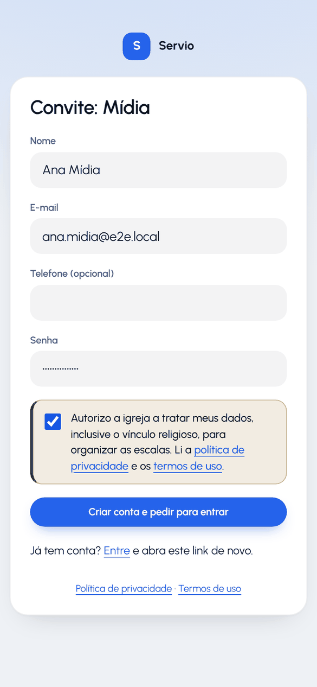 |  |  |

1. Abra o link que o líder mandou.
2. Preencha nome, e-mail e senha. O telefone é opcional.
3. Marque a autorização de dados e toque em **Criar conta e pedir para entrar**.
4. Marque as funções onde quer servir e toque em **Enviar pedido**.
5. Aguarde o líder aprovar.

Para mudar as funções depois, abra **Perfil → Onde quero servir**.

### 2. Confirmar a escala no Início

| Próxima escala | Confirmada |
|---|---|
|  | 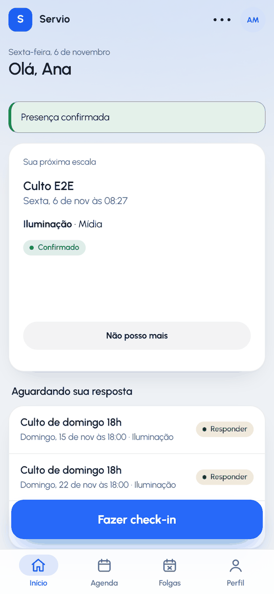 |

1. Abra **Início**. O cartão mostra a próxima escala: dia, hora, culto, função e colegas.
2. Toque em **Confirmar presença**.
3. Se não puder, toque em **Recusar** o mais cedo possível. Recusar com menos de 48 horas tira pontos.
4. Em **Aguardando sua resposta**, toque em **Responder** nas outras escalas.

O botão **Fazer check-in** aparece 2 horas antes do culto e fica até o fim dele. Toque nele ao chegar.

### 3. Marcar folga

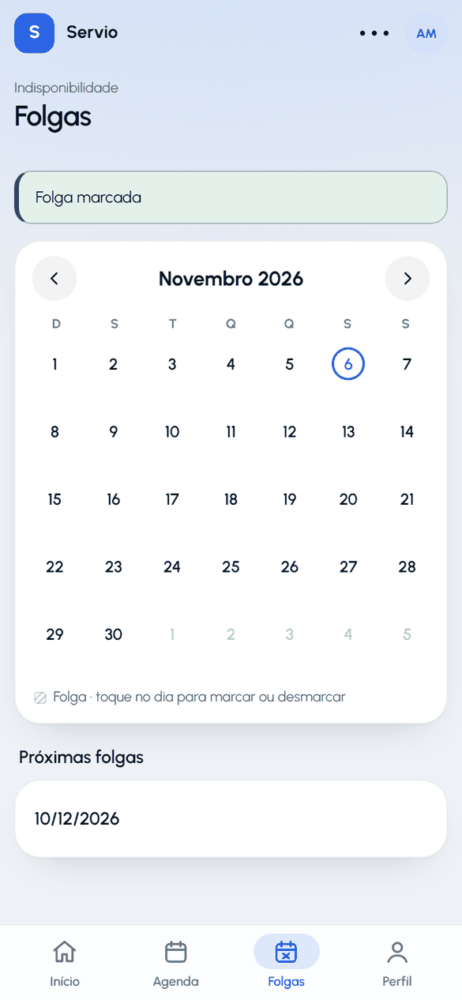

1. Abra **Folgas**.
2. Toque no dia em que não pode servir e toque em **Marcar folga**.
3. Para desmarcar, toque no mesmo dia e em **Remover folga**.

O líder vê só que você está de folga. A sugestão de escala não põe você nesse dia.

### 4. Agenda e troca

1. Abra **Agenda**. Os dias com escala ficam marcados.
2. Toque num dia marcado. Os detalhes abrem na folha inferior.
3. Para trocar, toque em **Pedir troca**, escolha quem pode assumir e toque em **Enviar pedido**.
4. A outra pessoa vê o pedido no **Início** e toca em **Aceitar** ou **Recusar**.
5. O líder aprova. A escala muda para a outra pessoa.

### 5. Perfil

- **Onde quero servir:** ministérios e funções desejadas.
- **Avisos:** ligue os avisos do celular.
- **Calendário do celular:** na **Agenda**, toque em **Calendário do celular** e em **Gerar link do calendário**. Assine o endereço no app de calendário. Toque em **Revogar link** para cancelar.
- **Reconhecimento:** pontos, medalhas e ranking do mês.
- **Privacidade:** baixe os seus dados ou exclua a conta.

| Ação | Pontos |
|---|---|
| Confirmar a escala | 10 |
| Fazer check-in | 5 |
| Assumir uma troca | 15 |
| Recusar com menos de 48 horas | −5 |

O ranking mostra só quem aceitou aparecer. Para sair, toque em **Sair do ranking** em **Reconhecimento**.
